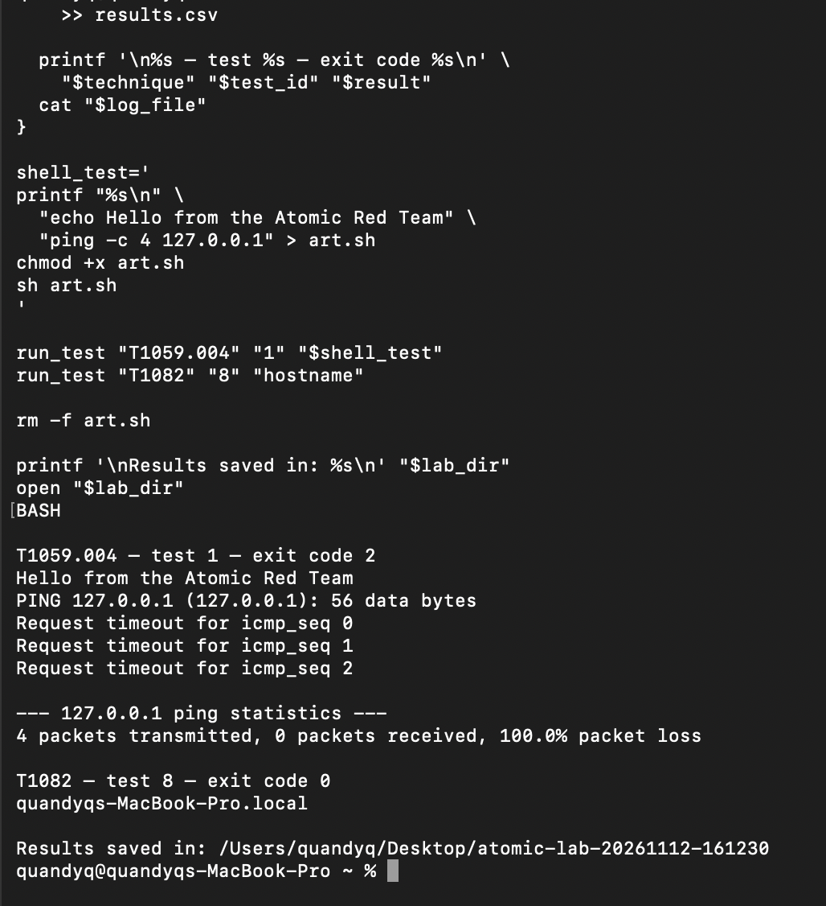
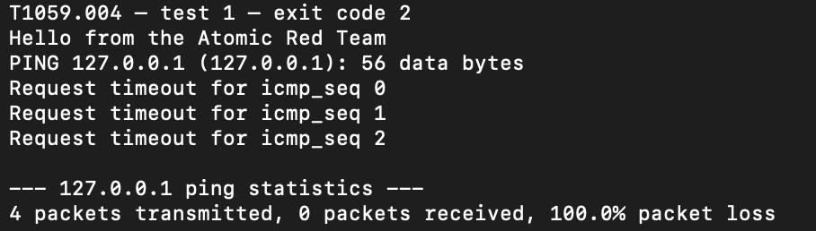
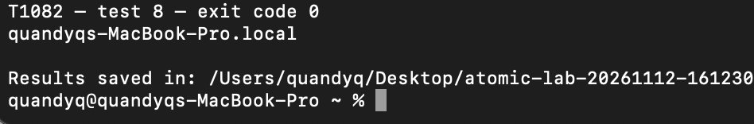
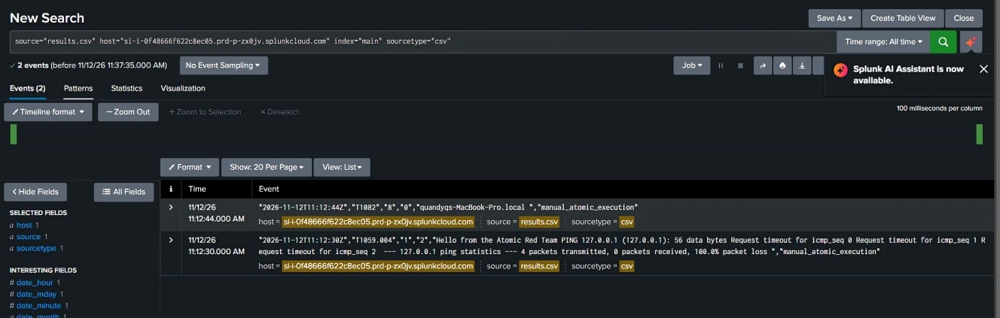
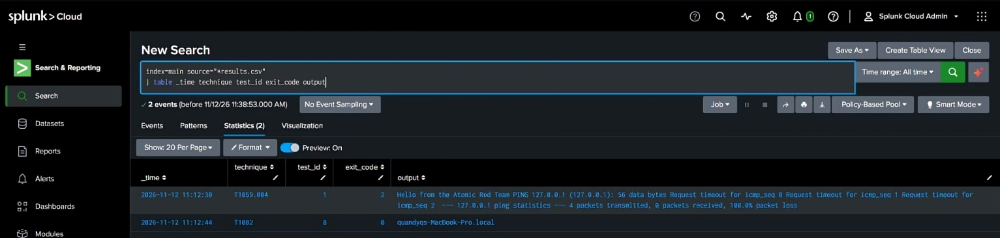
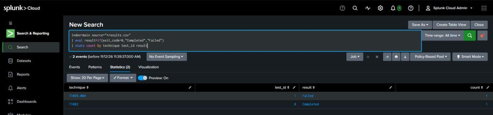

# APT29 TTP Analysis and ATT&CK Mapping

> Project context: Analysis of SIEM Priority Evasion Techniques and Development of Threat Hunting Scenarios for Low-Severity Threats

Lab 9 - Atomic Red Team

# 1. Introduction

This report describes a small Atomic Red Team exercise on macOS and the analysis of its execution records in Splunk Cloud. Atomic Red Team is a collection of focused tests mapped to MITRE ATT&CK. Each test reproduces a specific behavior so that analysts can examine execution, visibility, and detection. The official workflow permits manual execution of documented test commands, followed by review and cleanup.

2. Environment and Scope

The exercise uses a Mac as the test endpoint, Terminal for manual command execution, and Splunk Cloud Platform for indexing and searching results. The local recording script saves the UTC start time, technique ID, test number, exit code, combined command output, and record type to results.csv. Separate text logs retain the output of each test. Test execution and ingestion outcomes are recorded in the fields below.

macOS version: 27.0.1
  Splunk index: main

3 Selected Tests and ATTACK Mapping

| Tactic and technique | Atomic test | Behavior and expected evidence |
| --- | --- | --- |
| Execution T1059.004 Unix Shell | #1 Create and Execute Bash Shell Script | A shell script prints a greeting and sends four pings to localhost. Expected evidence: greeting, ping output, and an exit code. |
| Discovery T1082 System Information Discovery | #8 Hostname Discovery | The hostname command returns the endpoint name. Expected evidence: hostname output and an exit code. |

Both selected tests support macOS. For T1059.004, the script path is changed to art.sh inside the lab folder and the ping destination to 127.0.0.1. T1082 provides a second macOS-compatible example; credential dumping under T1003 is outside this exercise.

4. Test Execution and Local Evidence

Unix Shell Execution

The first test creates art.sh, marks it executable, and runs it through sh. Its contents are a greeting and four ICMP requests to 127.0.0.1. The loopback destination keeps the network activity on the test endpoint. This is a manual execution of the selected atomic with adjusted inputs.

printf "%s\n" "echo Hello from the Atomic Red Team" \
  "ping -c 4 127.0.0.1" > art.sh
chmod +x art.sh
sh art.sh

Observed exit code: [2]    Observed output: [insert brief finding]

Figure 1. Show the test identifier, greeting, ping responses, and recorded exit code.

Hostname Discovery

The second test runs hostname through the shell and records its output. This models a simple discovery behavior that can also occur during ordinary administration. It requires no credential access and makes no configuration changes. [3]

hostname

Observed exit code: [0]    Returned hostname: [quandyqs-MacBook-Pro.local]

Figure 2. Show the hostname result and recorded exit code.

5 Recording Results in Splunk Cloud

Data Ingestion

The evidence source is results.csv from the local test folder. The ingestion method is Settings → Add Data → Upload, with the csv source type and main index. The preview is used to check that the header becomes field names, the two data rows become separate events, and the timestamp is interpreted as UTC. Splunk supports file uploads and structured CSV field extraction. [4, 5]

Figure 3. Show the CSV source type, recognized fields, and two test records.

Event Review

The event review uses Search & Reporting with the time range set to All time. The search below displays the technique, test number, exit code, and command output for each indexed record. The timestamp and output are compared with the local logs to check consistency.

index=main source="*results.csv"
| table _time technique test_id exit_code output record_type

These events are labeled manual_atomic_execution. They are records generated by the test wrapper, rather than independently collected endpoint process events. Their presence demonstrates result ingestion; it does not establish that an attack detection rule fired.

6 Results and Analysis

| Test | Observed local result | Observed SIEM result |
| --- | --- | --- |
| T1059.004 Atomic #1 | Exit code:2 Greeting and ping result: Hello from the Atomic Red Team | Record present: Yes, failed |
| T1082 Atomic #8 | Exit code: 0 Hostname: Quandyqs-MacBook-Pro.local | Record present: Yes, completed |

An exit code of 0 supports successful command completion and must be read together with the output. A successful run can still be undetected. If a local result exists but no matching event is searchable, the first checks are the upload, selected index, time range, and field parsing. Repeated uploads can create duplicate events, so the event count is compared with the two local test records.

7. SIEM Interpretation for the Project

Shell execution and hostname discovery have limited meaning in isolation because both are common administrative actions. For the project, a useful hunting hypothesis is that unexpected shell execution followed by discovery on the same endpoint may deserve review even when individual events have low severity. Testing that relationship requires independently collected process events with host, account, command line, parent process, and timestamps. The current CSV records support execution analysis but do not validate that correlation.

8. Limitations and Conclusion

The exercise covers two basic macOS behaviors and manual result ingestion. It does not measure credential dumping, prevention, automatic alerting, or detection coverage. The test commands run on the authorized endpoint, with localhost used for the ping destination. Hostnames visible in submitted screenshots should be reviewed for unnecessary personal information.

Overall execution outcome: [insert finding supported by local logs]. SIEM ingestion outcome: [insert finding supported by the event search]. The exercise links selected Atomic tests to searchable evidence and distinguishes command completion from security detection. A next step is to collect endpoint process telemetry and evaluate a specific detection rule against the same test activity.

Lab 10 - APT29 TTP ANALYSIS AND ATTACK MAPPING

Project context: Analysis of SIEM Priority Evasion Techniques and Development of Threat Hunting Scenarios for Low-Severity Threats

# 1. Introduction

This report analyzes selected tactics, techniques, and procedures (TTPs) attributed to APT29 in the SolarWinds Compromise and maps them to MITRE ATT&CK. The selected behaviors show how a trusted software update could lead to execution, persistence, email collection, and exfiltration. The observations come from public campaign reporting and the ATT&CK campaign record; no local test, SIEM hunt, or incident investigation was performed for this report. [1]

# 2. Selected Group and Campaign

APT29 (G0016), also called Midnight Blizzard and The Dukes, is associated in ATT&CK with the SolarWinds Compromise (C0024). The campaign was discovered in December 2020. ATT&CK records that a compromised SolarWinds Orion update gave initial network access to some victims, followed by additional activity in a smaller subset of affected organizations. The rows below are a representative set of documented campaign behaviors, not a claim that every victim experienced the full sequence. [1, 2]

# 3. Observed Behavior and ATT&CK Mapping

| Stage and tactic | Technique | Reported APT29 behavior | Analyst evidence to seek |
| --- | --- | --- | --- |
| Initial access | T1195.002 Compromise Software Supply Chain | A trojanized Orion software update gave access to some victim networks. [1] | Update provenance; affected product versions; service and network activity after update. |
| Execution | T1059.001 PowerShell | PowerShell was used to create remote tasks, inspect settings, and perform other commands. [1] | Process creation and PowerShell logging; parent process, account, host, command line. |
| Persistence / execution | T1053.005 Scheduled Task | APT29 created or modified tasks, including a task associated with SUNSPOT persistence. [1] | Task creation/change records; task XML, action, creator, and subsequent process start. |
| Collection | T1114.002 Remote Email Collection | Targeted email from executives and IT staff was collected through Exchange mailbox export activity. [1] | Exchange administrative audit and mailbox access; export requests, accounts, and time. |
| Exfiltration | T1048.002 Encrypted Non-C2 Protocol | Collected data staged on a victim OWA server was retrieved over HTTPS. [1] | OWA/web server access and egress records; archive creation and transfer timing. |

# 4. How the Techniques Fit Together

The compromised update provided a plausible entry point because the code arrived through a trusted software distribution path. PowerShell and scheduled tasks then supported execution and continuing access. Mailbox export activity served the collection objective, while an HTTPS retrieval of staged data represented exfiltration. ATT&CK documents these behaviors within the campaign, but the public record does not establish this exact five-step order for every victim. [1]

# 5. SIEM Interpretation for the Project

A low-priority process event, a task change, or an ordinary-looking HTTPS request has limited meaning alone. A threat hunt can join records by host, account, and time window: unusual activity following an Orion update, PowerShell execution, a newly created or altered task, mailbox export activity, and web access to a staged archive. The result should be reviewed against approved administration and update activity before escalation. This is a proposed correlation hypothesis, not a tested detection rule.

| Telemetry | Question for the analyst | Interpretation limit |
| --- | --- | --- |
| Endpoint and task logs | Did an unexpected account create a task after suspicious execution? | Administrative maintenance can produce the same event types. |
| Exchange audit logs | Was a targeted mailbox export or unusual delegated access recorded? | A missing audit record may reflect collection settings. |
| Web and egress logs | Did archive access or outbound HTTPS align with collection? | Encrypted traffic metadata alone does not prove data theft. |

# 6. Limitations

ATT&CK is a curated summary of public reporting, and some campaign procedures are sourced from different victim investigations. This report does not independently verify attribution or reconstruct a single complete intrusion. Mapping a behavior to an ATT&CK ID describes what was reported; it does not establish that a local environment contains that behavior. Detection quality also depends on audit policy, retention, source coverage, field extraction, and SIEM time range.

# 7. Conclusion and Next Steps

The selected APT29 case illustrates a progression from supply chain access to execution, persistence, collection, and exfiltration, with five mapped ATT&CK techniques. For the SIEM project, the useful next step is to turn one relationship—such as an unexpected task change following PowerShell activity—into a bounded hunting hypothesis, verify the required data sources, and distinguish routine administration from a suspicious chain before claiming detection.

# References

[1] MITRE ATT&CK. SolarWinds Compromise (C0024). https://attack.mitre.org/campaigns/C0024/

[2] MITRE ATT&CK. APT29 (G0016). https://attack.mitre.org/groups/G0016/
