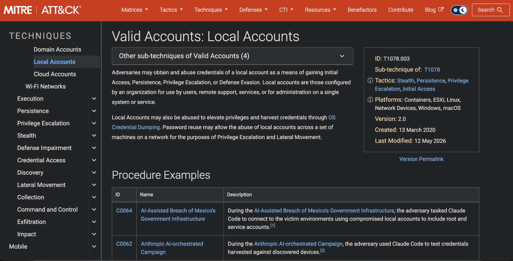
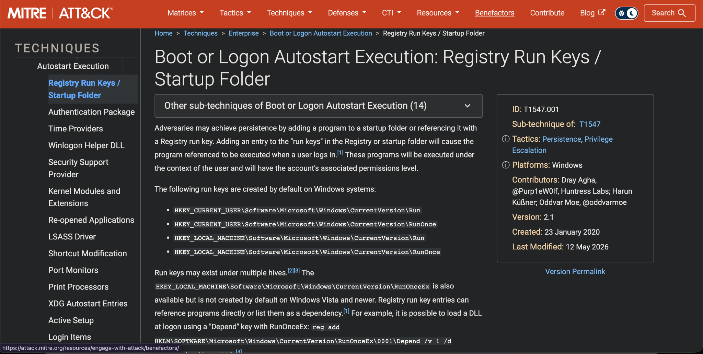

# WEEK 8 — ADVERSARY EMULATION PLAN

**Initial Access → Persistence → Data Exfiltration | ATT&CK Project Increment**

**Project context:** Analysis of SIEM priority evasion techniques and development of threat hunting scenarios for low-severity threats.

## 1. Introduction

This plan tests whether a Windows lab and its SIEM can observe a short sequence of attacker-like behavior: use of a local account, an autostart entry, and transfer of a synthetic file to a controlled receiver. It is a proposed exercise, not a record of completed testing. The sequence is mapped to MITRE ATT&CK so that each action has a defined objective, expected telemetry, and review criterion.

## 2. Scenario and Scope

**Scenario:** An operator starts with the credentials of a precreated, low-privilege local test account on one Windows workstation. After signing in, the operator configures a harmless test program to start at the next logon. The operator then sends a small synthetic file over HTTP to an isolated lab receiver. No real user data, production host, public destination, or credential collection is in scope.

**Preconditions:**
- One approved Windows VM.
- One isolated HTTP receiver.
- A dedicated test account.
- A uniquely named test file.
- A documented exercise window.
- Windows Security, Sysmon (if installed), and receiver or proxy logs collected into the SIEM.
- Clock synchronization and log ingestion confirmed before beginning.

## 3. Selected ATT&CK Techniques

| Phase | ATT&CK technique | Emulated behavior | Evidence to collect |
|---|---|---|---|
| Initial access | **T1078.003 — Valid Accounts: Local Accounts** | Sign in to the lab workstation using the dedicated local test account. | Windows Security Event ID 4624; account, host, logon type, source, and timestamp. |
| Persistence | **T1547.001 — Registry Run Keys / Startup Folder** | Create a current-user autostart entry for a benign marker program, then sign out and back in. | Registry change (Sysmon Event ID 13 if configured); process creation (Event ID 4688 or Sysmon Event ID 1). |
| Exfiltration | **T1048.003 — Exfiltration Over Unencrypted Non-C2 Protocol** | Send only the synthetic file by HTTP to the separate lab receiver. | HTTP request, destination, byte count, receiver receipt, and file hash. |

### ATT&CK reference screenshots

**Figure 1. T1078.003 — Valid Accounts: Local Accounts**  

**Figure 2. T1547.001 — Registry Run Keys / Startup Folder**  

**Figure 3. T1048.003 — Exfiltration Over Unencrypted Non-C2 Protocol**  

## 4. Test Procedure

### 4.1 Preparation

Record the VM name, test account, receiver address, start time, file name, file size, and SHA-256 hash in the exercise worksheet. Label the file as synthetic test data. Verify that the receiver accepts connections only from the lab network and that the intended telemetry arrives in the SIEM. Capture a pretest baseline for account logons, autostart entries, and HTTP traffic.

### 4.2 Initial access

Use the supplied local test account to sign in to the approved VM once. Record the exact sign-in time and session details. This emulates abuse of already obtained credentials; it does not test how credentials were stolen. Check for a matching Security Event ID 4624 and confirm that it can be located by account and host in the SIEM.

### 4.3 Persistence

Under the test account, add one clearly labeled entry to that user’s Run key or Startup folder that starts a harmless marker program. The marker should write only a timestamped “emulation test” message to a lab file. Sign out and back in once. Confirm the entry exists, the marker runs at logon, and the registry or file change and subsequent process creation are visible. Record the entry name and path so it can be removed.

### 4.4 Data exfiltration simulation

Create a small synthetic text file containing only the exercise identifier and dummy values. Transfer that file over plain HTTP from the VM to the isolated receiver, which is separate from any command-and-control channel. Compare the receiver’s file hash and byte count with the original; retain the request and receiver logs. This validates observable transfer behavior only, with no sensitive data leaving the lab.

## 5. Evidence and Evaluation

For each phase, store the execution timestamp and a screenshot or exported event showing the host, account, action, and relevant fields. Correlate the three stages by test account, host, and time window. In the SIEM, search for the 4624 logon, the autostart modification plus logon-triggered process, and the HTTP transfer to the lab receiver. Do not infer success from a broad event count alone.

| Phase | Pass condition | Record if absent |
|---|---|---|
| Initial access | Test logon is visible locally and in the SIEM. | Check audit policy, account name, host filter, and collection delay. |
| Persistence | Autostart entry and marker execution after sign-in are both evidenced. | Check Sysmon/registry coverage and process command-line collection. |
| Exfiltration | Receiver obtains matching synthetic file; network logs identify transfer. | Check receiver access, proxy/flow coverage, byte fields, and time range. |

## 6. Limitations and Cleanup

A dedicated account sign-in is a simplified stand-in for misuse of compromised credentials, and an isolated HTTP transfer cannot fully reproduce real data theft. Sysmon events depend on its installed configuration; Security Event IDs 4688 and 4624 depend on audit settings and ingestion. A missing SIEM event may reflect collection or query gaps rather than absence of the activity. This three-stage plan omits discovery, collection, staging, and command and control.

After evidence is saved:
- Remove the autostart entry and marker file.
- Delete the synthetic file from the VM and receiver.
- Disable or reset the test account.
- Verify that no test entry remains.
- Record actual timestamps, event IDs, SIEM queries, observed counts, gaps, and cleanup confirmation in the final exercise report.

## 7. Conclusion and Next Steps

The plan gives a small, repeatable chain for testing whether the SIEM can connect a local account logon, a persistence change, and an outbound file transfer. Run it only in the defined lab, compare actual evidence with the pass conditions, and use any visibility gaps to prioritize audit configuration, forwarding, and correlation improvements. No detection or successful exfiltration is claimed until the exercise is performed and the records are reviewed.

## References

- MITRE Center for Threat-Informed Defense. [Adversary Emulation Library](https://ctid.mitre.org/resources/adversary-emulation-library/).
- MITRE ATT&CK. [Valid Accounts: Local Accounts (T1078.003)](https://attack.mitre.org/techniques/T1078/003/).
- MITRE ATT&CK. [Registry Run Keys / Startup Folder (T1547.001)](https://attack.mitre.org/techniques/T1547/001/).
- MITRE ATT&CK. [Exfiltration Over Unencrypted Non-C2 Protocol (T1048.003)](https://attack.mitre.org/techniques/T1048/003/).
- MITRE ATT&CK. Detection strategies DET0407, DET0365, and DET0149. [Detection Strategies](https://attack.mitre.org/detectionstrategies/).

---

**Status:** This is a proposed plan, not a completed test. Add real screenshots, event exports, actual query results, and cleanup confirmation after the approved lab exercise.
