# WEEK 6 — ATT&CK FRAMEWORK REPORT

## T1059.001 — PowerShell | Weekly Project Increment

Group topic: Analysis of SIEM Priority Evasion Techniques and Development of Threat Hunting Scenarios for Low-Severity Threats

## 1. Introduction

This weekly increment applies MITRE ATT&CK to our threat hunting project. We selected T1059.001 — PowerShell and conducted a controlled, harmless test to check whether process execution is visible in local Windows logs and Splunk. Conclusions must be based on the evidence collected.

## 2. Selected Technique

T1059.001 — PowerShell describes the use of PowerShell as a command and scripting interpreter. PowerShell is used for legitimate administration as well as potentially malicious activity, so its presence alone is not sufficient to classify an event as malicious.

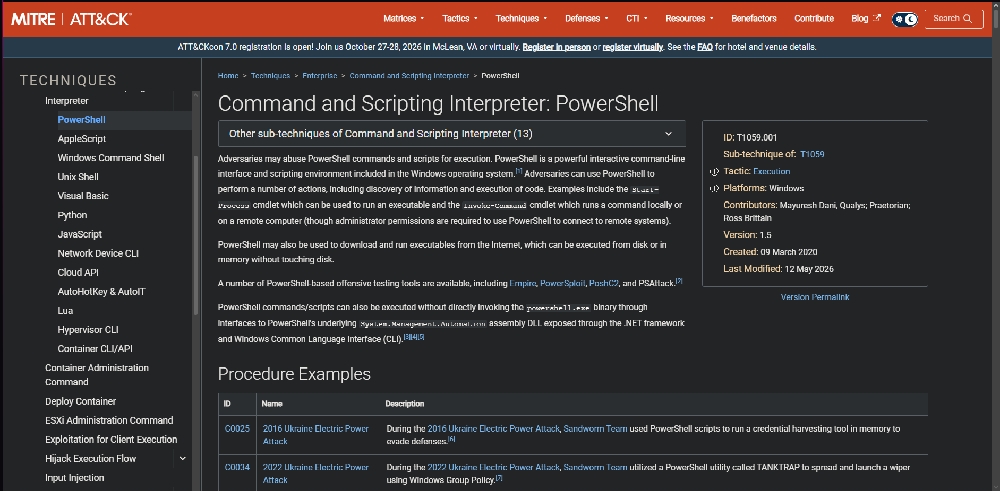

Reference: https://attack.mitre.org/techniques/T1059/001/

## 3. Test Environment and Procedure

Host: WIN-80IF6H6KAFQ  
Date/time: 13 октября 2026 г. 14:14:35  
Command: Write-Output "Week 6 ATT&CK test"  
The command only prints a text message and does not contact external infrastructure or modify the system.

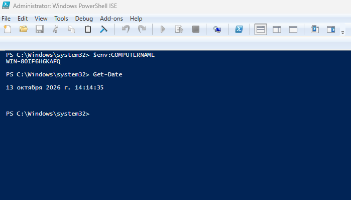

## 4. Windows Security Results

Event ID 4688 records process creation when the relevant audit policy is enabled. Result: **10 events found.** Notes: **13.10.2026 14:18:17-21 4688 Microsoft-Windows-Security-Auditing A new process has been created....**

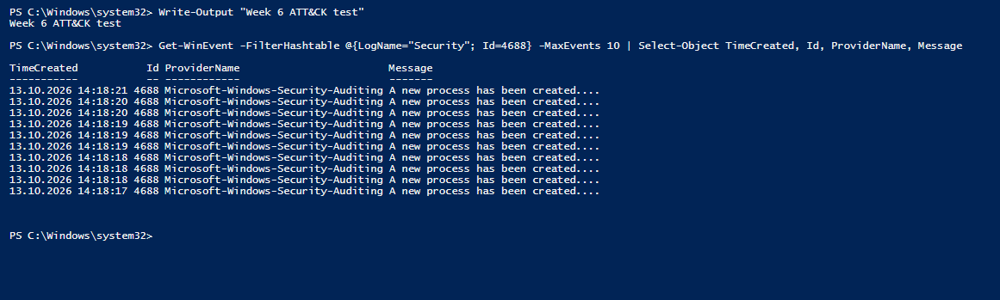

The 4688 events are accessible to inspect inside the Event Viewer, which requires to filter the logs with the specific ID.

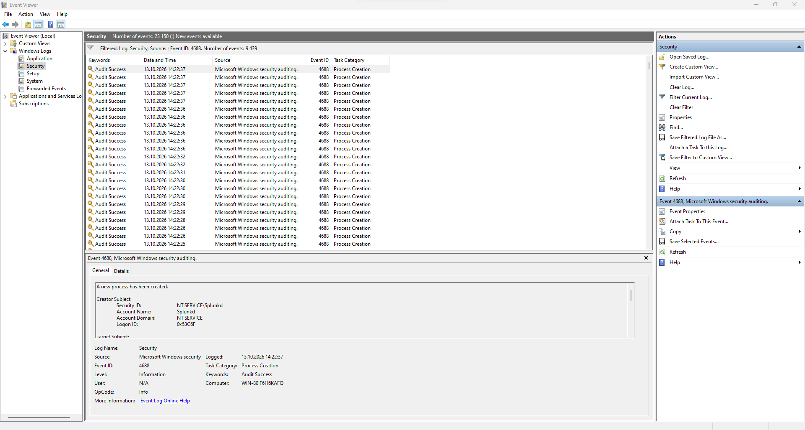

## 5. Sysmon Results

Sysmon Event ID 1 records process creation, and Event ID 5 records process termination.

**Result:** Found — 137 records were observed in the local Sysmon Operational log.

**Notes:** The local Sysmon log contained process creation events (Event ID 1) and process termination events (Event ID 5). These records show that Sysmon was recording events locally. However, the presence of local records does not confirm that Sysmon Operational events were successfully forwarded to and indexed in Splunk.

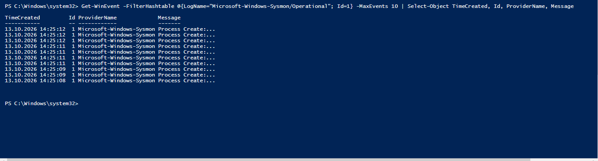

## 6. Splunk Results

Windows Security query:

```spl
index=main sourcetype="WinEventLog:Security" EventCode=4688
| table _time host EventCode Message
| sort -_time
```

**Result count:** 31,989 events for the last 24 hours.

**Observation:** The search returned 31,989 events with Event ID 4688 during the selected time range. This event ID records process creation in Windows Security logs. The results confirm that process creation telemetry is available in Splunk. The event details include the process name, creator process, account information, and command line when available. This provides a baseline for further threat hunting. However, the presence of process creation events alone does not indicate malicious activity.

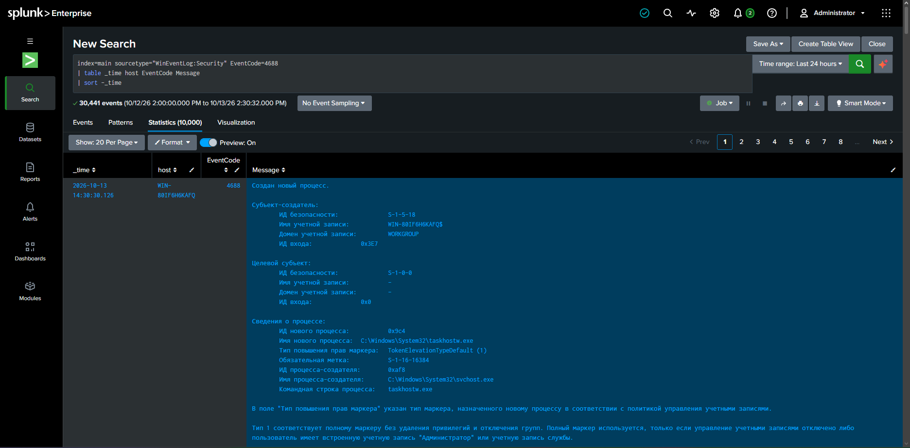

PowerShell query:

index=main sourcetype="WinEventLog:Security" EventCode=4688 ("powershell.exe" OR "pwsh.exe")

**Result count:** 529 events for the selected time range.

**Observation:** The search returned 529 events matching the PowerShell-related search criteria. However, the visible results mainly showed splunk-powershell.exe, launched by Splunk components such as splunk.exe and splunkd.exe. These events appear to be related to normal Splunk operations rather than confirmed malicious activity. This demonstrates that process name matching alone can produce benign results and that additional context is required to distinguish normal activity from suspicious behavior.

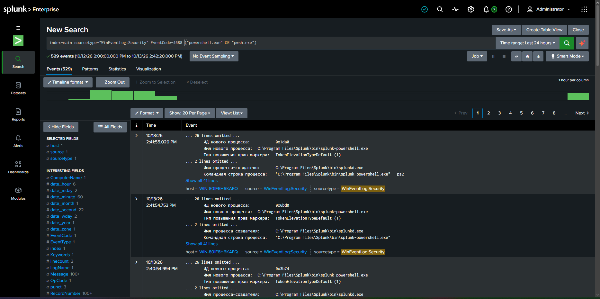

Sysmon search: index=main "Sysmon"  
Index: main  
Sourcetype: WinEventLog:Security (as displayed in the returned events)  
Time range: Custom date/time range, October 9, 2026, 7:00 PM–8:00 PM  
Result: Found — 11 events.

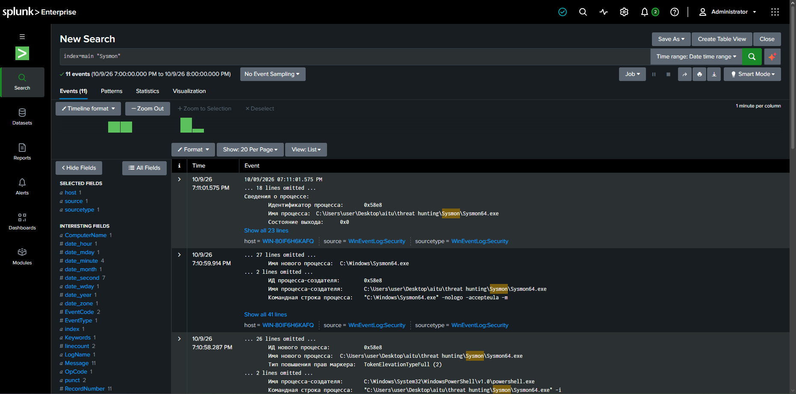

The search returned 11 events containing the term "Sysmon". However, the returned events used the WinEventLog:Security sourcetype and included references to the Sysmon executable. Therefore, this search does not confirm that Sysmon Operational events are being ingested into Splunk.

## 7. ATT&CK Mapping and Interpretation

| **Item**              | **Evidence**                                                                                                                                    | **Interpretation**                                                               |
|-----------------------|-------------------------------------------------------------------------------------------------------------------------------------------------|----------------------------------------------------------------------------------|
| **Technique**         | T1059.001 — PowerShell                                                                                                                          | Describes the behavior tested.                                                   |
| **Process creation**  | Windows Security Event ID 4688; Splunk returned 31,989 events.                                                                                  | Shows only what the log records.                                                 |
| **Splunk visibility** | Windows Security events: found. Sysmon search: 11 results for index=main "Sysmon", but the returned events had sourcetype WinEventLog:Security. | Missing results may indicate a collection, indexing, field, or time-range issue. |
| **Attack conclusion** | A harmless PowerShell test was performed. No confirmed malicious activity was established.                                                      | Do not claim malicious activity or SIEM priority evasion without evidence.       |

## 8. Limitations

Results depend on Windows audit policy, Sysmon configuration, Splunk collection settings, index, sourcetype, and time range. A zero-result search does not prove that behavior never occurred. This harmless test checks process-execution telemetry only; it does not demonstrate a complete attack chain or SIEM priority evasion.

## 9. Conclusion and Next Steps

Based on the collected evidence, Windows Security Event ID 4688 process creation events were available in Splunk, with 31,989 matching events in the selected time range. The PowerShell-related search returned 529 events. The visible results included splunk-powershell.exe, launched by Splunk components, and did not provide evidence of a confirmed attack.

The local Sysmon Operational log contained 137 records, including Event ID 1 (Process Create) and Event ID 5 (Process Terminate). However, the Splunk search index=main "Sysmon" returned 11 events with the sourcetype WinEventLog:Security. Therefore, the ingestion of Sysmon Operational events into Splunk was not confirmed.

In conclusion, this test demonstrated that process creation telemetry was available in Splunk, but it did not demonstrate a confirmed attack or successful SIEM priority evasion. The next steps are to verify Sysmon forwarding and indexing, check the relevant sources and fields, and repeat the hunt using correlated process and network events. These findings can help the team select a suitable MITRE CAR analytic for Week 7.

# **References**

MITRE ATT&CK. PowerShell (T1059.001). https://attack.mitre.org/techniques/T1059/001/

MITRE ATT&CK. Command and Scripting Interpreter (T1059). https://attack.mitre.org/techniques/T1059/

Introduction to Threat Hunting syllabus, Academic Year 2026–2027, Section 3.3, Week 6 — ATT&CK Framework.

# WEEK 7 — USING MITRE CAR (Cyber Analytics Repository)

## 1. Introduction

### 1.1 Overview

In modern security operations, effective threat detection requires structured frameworks to transform raw log data into actionable alerts. Two foundational repositories maintained by MITRE are the **Cyber Analytics Repository (CAR)** and the **ATT&CK Framework**.

- **MITRE CAR (Cyber Analytics Repository)** is a knowledge base of analytics designed to detect threat actor behaviors. It provides pseudocode, log data source requirements, and logic for identifying malicious activity.

- **Analytics vs. Detections**: An *Analytic* represents the abstract conceptual logic or query designed to search for specific telemetry patterns (e.g., detecting cmd.exe spawned by w3wp.exe). A *Detection* (or Detection Rule) is the specific, vendor-tuned implementation of that analytic within an operational security platform (e.g., a Splunk alert rule or Elastic SIEM detection rule) configured with specific thresholds, suppressions, and response actions.

### 1.2 Objective

The objective of this assignment is to select a cyber analytic model from MITRE CAR (car.mitre.org), map it to corresponding techniques in the MITRE ATT&CK framework, and implement it as a detection rule within a SIEM environment.

## 2. Selected Analytic & MITRE ATT&CK Mapping

### 2.1 Selected CAR Analytic

- **CAR ID:** CAR-2016-03-002

- **Analytic Name:**Create Remote Process via WMIC

- **Description:** **Description:** Adversaries may use Windows Management Instrumentation (WMI) to execute commands or malicious payloads on remote systems. WMI is a native administrative feature that can be abused for lateral movement. This analytic tracks the execution of wmic.exe with process creation arguments (such as process call create), allowing security teams to detect unauthorized remote command execution.

### 2.2 MITRE ATT&CK Mapping

- **Technique:** Windows Management Instrumentation (T1047)

- **Tactic:** Execution / Lateral Movement

- **Platform:** Windows

- **Required Data Sources:** Process Creation (e.g., Windows Security Event ID 4688 or Sysmon Event ID 1, capturing command-line arguments and parent-child process relationships)

## 3. SIEM Implementation

### 3.1 Data Source & Telemetry Configuration

To enable detection for this analytic, the target system must forward process creation logs to the SIEM. The required log fields include:

- Image / NewProcessName (Executable name)

- CommandLine / ProcessCommandLine (Arguments passed to execution)

- ParentImage / ParentProcessName (Parent process execution context)

### 3.2 Detection Rule Logic (Query)

The pseudo-logic provided by MITRE CAR was adapted into a vendor-specific SIEM search query.

**SIEM Platform:** Elastic SIEM /**Query / Rule Syntax:**

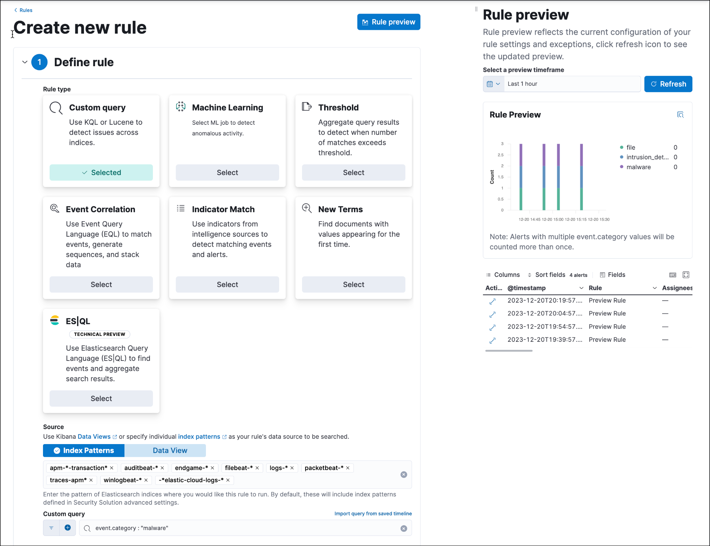

## 4. Verification & Testing

### 4.1 Test Execution (PoC)

To verify the detection rule, a simulated attack activity was triggered in the test environment using the following command:

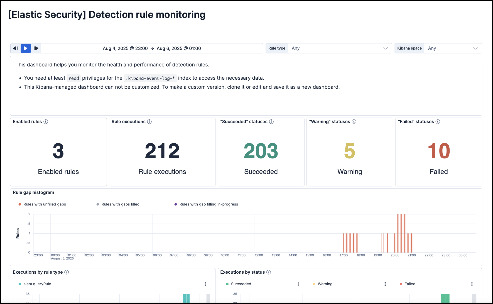

### 4.2 Detection Results

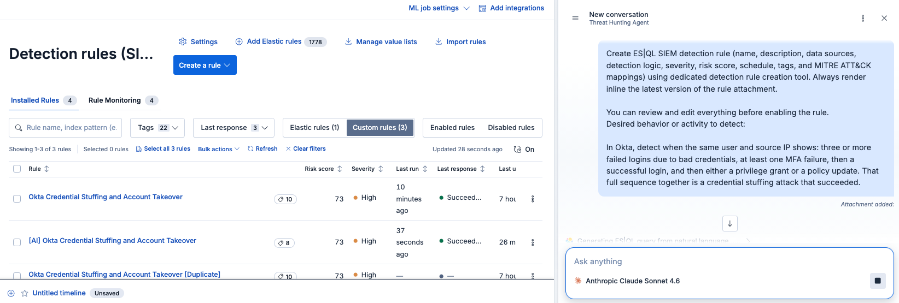

<u>1 644 × 555</u>

<u>1 644 × 555</u>

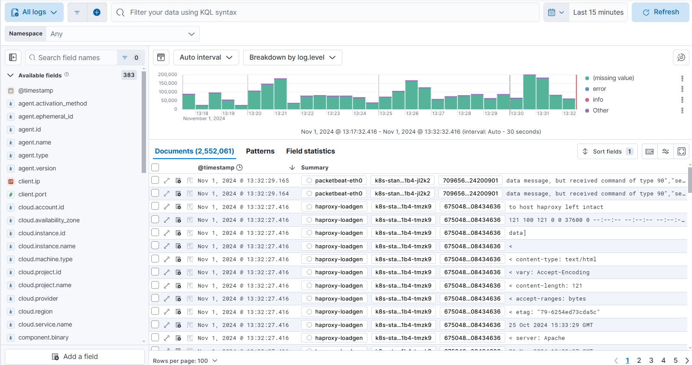  
*Figure 2: Alert / Search Trigger Result in SIEM*

## 5. Discussion & Fine-Tuning

### 5.1 False Positive Analysis

Legitimate administrative scripts and remote management tools may utilize this process invocation. To reduce false positives, baseline exclusions can be added based on:

- Approved management workstations or Service Accounts.

- Verified administrative scripts signed by trusted publishers.

### 5.2 Analytic Limitations

Adversaries may attempt to bypass this analytic by bypassing command-line logging, utilizing unmonitored API calls, or using obfuscated PowerShell execution paths.

## 6. Conclusion

In this lab, a threat detection analytic was selected from the MITRE Cyber Analytics Repository, mapped to the MITRE ATT&CK framework, and translated into an operational SIEM detection rule. This process demonstrates how standardized threat intelligence repositories enable SOC analysts to build proactive detection engineering pipelines.

**References**

MITRE CAR Repository. Available at: [<u>https://car.mitre.org</u>](https://car.mitre.org/)

MITRE ATT&CK Matrix for Enterprise. Available at: [<u>https://attack.mitre.org</u>](https://attack.mitre.org/)

MITRE CAR Documentation. Available at: [<u>https://car.mitre.org/docs/</u>](https://www.google.com/search?q=https://car.mitre.org/docs/)
